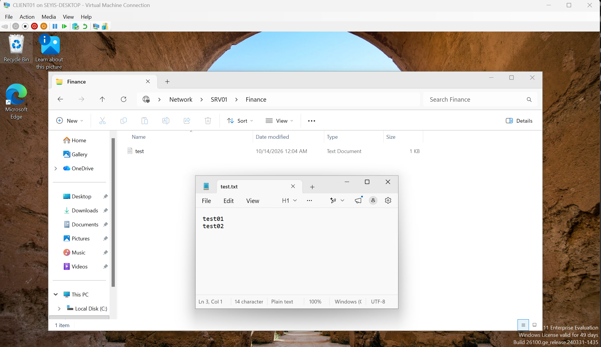
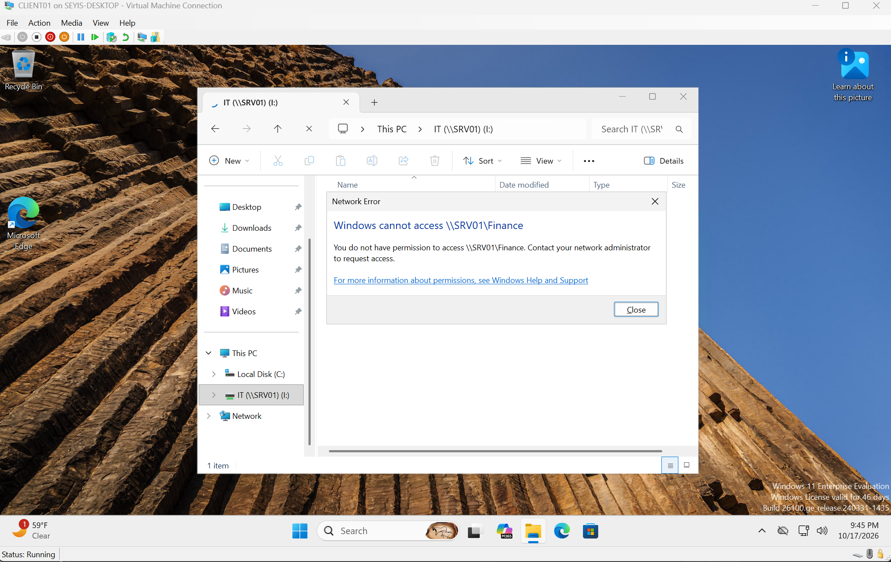

# Active Directory Enterprise Lab

A Windows enterprise homelab built with Hyper-V, Windows Server 2025, Windows 11 Enterprise, Active Directory Domain Services, DNS, DHCP, Group Policy, file services, and PowerShell.

The goal of this project is to build practical experience with Windows administration, networking, identity management, automation, and troubleshooting.

## Lab Overview

| System | Role |
|---|---|
| DC01 | Active Directory Domain Services, DNS |
| SRV01 | DHCP, File Services |
| CLIENT01 | Windows 11 domain workstation |
| Windows 11 Host | Hyper-V and NAT |

**Domain:** `corp.adlab.test`  
**Lab Network:** `10.10.10.0/24`

## Features

- Active Directory Domain Services
- Active Directory-integrated DNS
- DHCP
- Organizational Unit (OU)
- Domain users and groups
- Windows domain joins
- Group Policy
- File and NTFS permissions
- PowerShell automation
- Hyper-V networking and NAT
- Troubleshooting documentation

## Documentation

- [Lab Architecture](./docs/architecture.md)
- [Active Directory](./docs/active-directory.md)
- [Group Policy](./docs/group-policy.md)
- [File Services](./docs/file-services.md)
- [Troubleshooting](./docs/troubleshooting.md)

## Role-Based Access in Action

Department shares on SRV01 are protected with AD security groups using the AGDLP model. A member of the Finance group can open and edit files on `\\SRV01\Finance`, while a user outside Finance is denied.

<table>
  <tr>
    <td width="50%"></td>
    <td width="50%"></td>
  </tr>
  <tr>
    <td align="center"><b>Authorized:</b> Finance user creates and edits a file</td>
    <td align="center"><b>Denied:</b> user outside Finance is blocked</td>
  </tr>
</table>

See [File Services](./docs/file-services.md) for the full permission design.

## PowerShell Automation

PowerShell scripts are used to automate common administration tasks.

[`New-ADUsersFromCsv.ps1`](./scripts/powershell/New-ADUsersFromCsv.ps1) provisions users into their department OUs from fictional CSV data stored in [`data/users.csv`](./data/users.csv).

Planned improvements include duplicate checks, logging, validation, group assignment, and error handling.

## Skills Demonstrated

- Windows Server administration
- Active Directory
- DNS and DHCP
- Group Policy
- Hyper-V
- PowerShell
- IPv4 networking
- Identity and access management
- Windows troubleshooting

## Project Status

### Completed
- Hyper-V internal network
- NAT connectivity
- DC01 deployment
- Active Directory forest
- DNS
- OU structure
- User creation
- PowerShell provisioning
- CLIENT01 domain join
- SRV01 deployment
- DHCP role and AD authorization
- DHCP client configuration
- Group Policy
- File services
- Security groups
- Permissions

### In Progress
- Expanded PowerShell automation
- Hybrid identity management (Microsoft Entra ID)