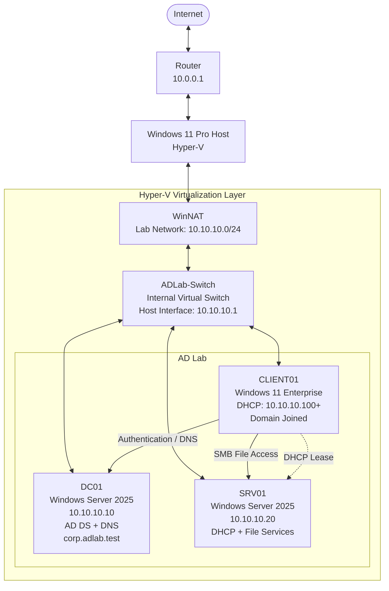

# Active Directory Enterprise Lab

A Windows enterprise homelab built with Hyper-V, Windows Server 2025, Windows 11 Enterprise, Active Directory Domain Services, DNS, DHCP, Group Policy, file services, and PowerShell.

The goal of this project is to build practical experience with Windows administration, networking, identity management, automation, and troubleshooting.

## Lab Overview



| System | Role |
|---|---|
| DC01 | Active Directory Domain Services, DNS |
| SRV01 | DHCP, File Services |
| CLIENT01 | Windows 11 domain workstation |
| Windows 11 Host | Hyper-V and NAT |

**Domain:** `corp.adlab.test`  
**Lab Network:** `10.10.10.0/24`

For the full network and Active Directory design, see [Architecture](./docs/architecture.md).

## Features

- Active Directory Domain Services
- Active Directory-integrated DNS
- DHCP
- Organizational Unit (OU)
- Domain users and groups
- Windows domain joins
- Group Policy
- File and NTFS permissions
- PowerShell automation
- Hyper-V networking and NAT
- Troubleshooting documentation

## PowerShell Automation

PowerShell scripts are used to automate common administration tasks.

User provisioning is performed from fictional CSV data stored in:

```text
data/users.csv
```

Planned improvements include duplicate checks, logging, validation, group assignment, and error handling.

## Troubleshooting

Problems encountered during the build are documented using:

```text
Issue
Symptoms
Investigation
Root Cause
Resolution
Validation
```

See [Troubleshooting](./docs/troubleshooting.md) for full write-ups.

## Skills Demonstrated

- Windows Server administration
- Active Directory
- DNS and DHCP
- Group Policy
- Hyper-V
- PowerShell
- IPv4 networking
- Identity and access management
- Windows troubleshooting

## Project Status

### Completed
- Hyper-V internal network
- NAT connectivity
- DC01 deployment
- Active Directory forest
- DNS
- OU structure
- User creation
- PowerShell provisioning
- CLIENT01 domain join
- SRV01 deployment
- DHCP role and AD authorization
- DHCP client configuration
- Group Policy
- File services
- Security groups
- Permissions


See [Screenshots](./screenshots/) for validation.

### In Progress
- Expanded PowerShell automation
- Hybrid enterprise environment