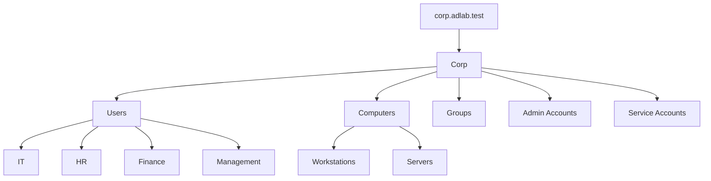
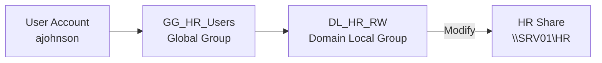

# Active Directory Management

## Overview



Active Directory is used to centrally manage users, computers, and security groups in the `corp.adlab.test` domain.

## Configuration
- Created departmental OUs for IT, HR, Finance, and Management.
- Created domain users using PowerShell and a CSV file.
- Implementing security groups to manage departmental access.

### Security Groups

| Global Groups | Domain Local Groups |
|---|---|
| GG_HR_Users | DL_HR_RW |
| GG_Finance_Users | DL_Finance_RW |
| GG_IT_Users | DL_IT_RW |

This lab implements the **AGDLP** model:



Accounts → Global Groups → Domain Local Groups → Permissions

## Validation

```powershell
Get-ADUser -Filter *
Get-ADGroupMember -Identity "GG_HR_Users"
```

## Key Takeaway
Security groups simplify permission management by assigning access to groups instead of individual users.