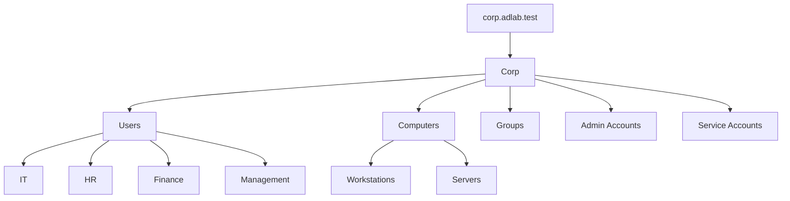
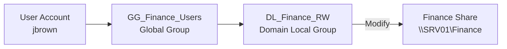
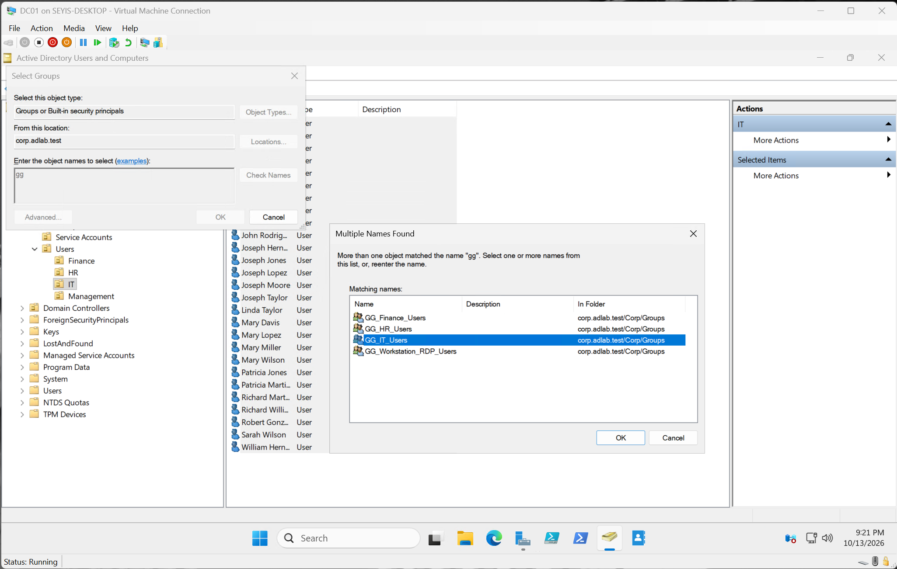

# Active Directory Management

## Overview



Active Directory is used to centrally manage users, computers, and security groups in the `corp.adlab.test` domain.


## Configuration
- Created departmental OUs for IT, HR, Finance, and Management.
- Created domain users using PowerShell and a CSV file.
- Implemented security groups to manage departmental access.

### Security Groups

All groups are stored in the [Corp\Groups](../screenshots/security/security_groups.png) OU.

| Global Group | Domain Local Group | Resource |
|---|---|---|
| GG_HR_Users | DL_HR_RW | `\\SRV01\HR` |
| GG_Finance_Users | DL_Finance_RW | `\\SRV01\Finance` |
| GG_IT_Users | DL_IT_RW | `\\SRV01\IT` |

This lab implements the **AGDLP** model:



Accounts → Global Groups → Domain Local Groups → Permissions

Users were added to their department's global group, and only the domain local group is granted permissions on the resource:



## Validation

```powershell
Get-ADUser -Filter *
Get-ADGroupMember -Identity "GG_Finance_Users"
```

## Key Takeaway
Security groups simplify permission management by assigning access to groups instead of individual users.