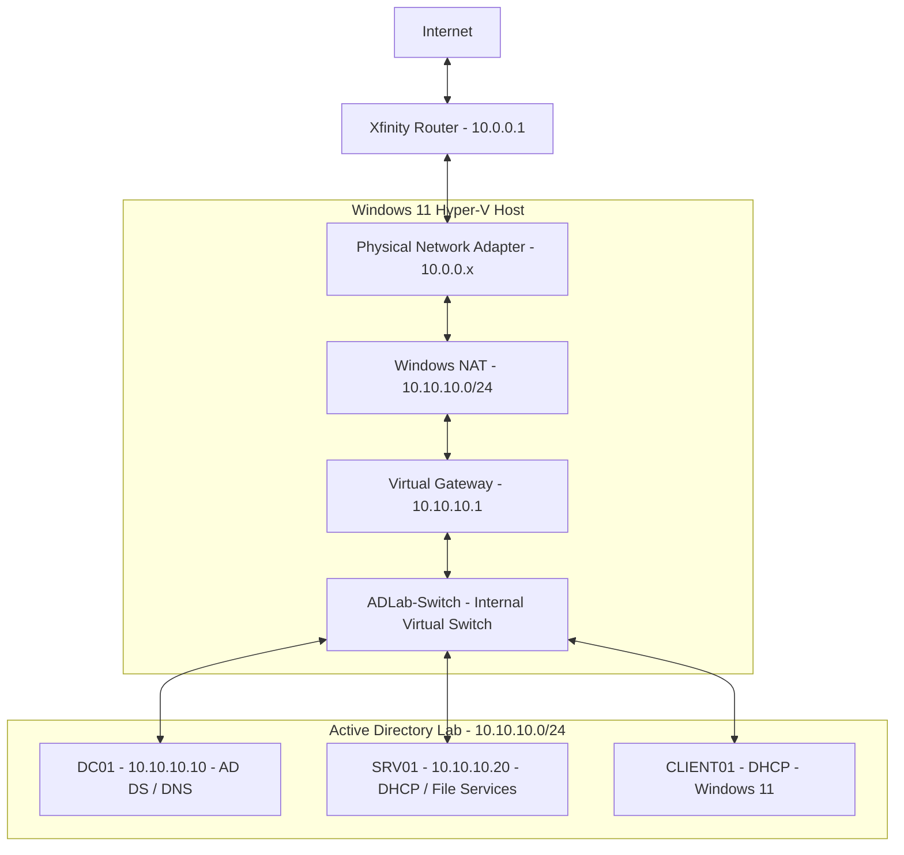

# Lab Architecture

## Overview

This homelab simulates a small Windows enterprise environment using Hyper-V. The lab is designed to provide hands-on experience with Active Directory, DNS, DHCP, Group Policy, file services, PowerShell automation, and Windows client administration.

The environment is isolated from my physical home network using a Hyper-V Internal Virtual Switch. Network Address Translation (NAT) allows the lab environment to access the internet through a Windows 11 host without placing the virtual machines directly on the home LAN.

The Active Directory domain name used throughout the lab is:

```text
corp.adlab.test
```

## Network Architecture



The lab uses the private subnet:

```text
10.10.10.0/24
```

The Windows 11 Hyper-V host provides the lab gateway through its virtual network adapter:

```text
10.10.10.1
```

Lab virtual machines use this address as their default gateway.

The physical host remains connected to the home network separately. My home router uses the `10.0.0.0/24` network, keeping the physical and virtual lab networks separate.


## Virtual Network

A Hyper-V Internal Virtual Switch named `ADLab-Switch` connects the host and all virtual machines.

The internal switch allows communication between lab VMs while keeping them isolated from devices on the physical home network.

NAT is configured for:

```text
10.10.10.0/24
```

## Systems

| System | Operating System | IP Address | Purpose |
|---|---|---:|---|
| Hyper-V Host | Windows 11 Pro | `10.10.10.1` on lab interface | Hypervisor and NAT gateway |
| DC01 | Windows Server 2025 | `10.10.10.10` | Domain Controller, AD DS, DNS |
| SRV01 | Windows Server 2025 | `10.10.10.20` | DHCP and File Services |
| CLIENT01 | Windows 11 Enterprise | DHCP | Domain-joined workstation |

This is what I've implemented so far, additional systems may be added as the lab expands.

## Active Directory Design

The lab contains a single Active Directory forest and domain:

```text
Forest: corp.adlab.test
Domain: corp.adlab.test
NetBIOS Name: CORP
```

DC01 is the primary Domain Controller and provides:

- Active Directory Domain Services
- DNS
- Domain authentication
- Group Policy infrastructure
- Active Directory object management

The organizational unit structure is designed to separate users, computers, administrative accounts, service accounts, and departments.

```text
corp.adlab.test
|
└── Corp
    ├── Users
    │   ├── IT
    │   ├── HR
    │   ├── Finance
    │   └── Management
    |
    ├── Computers
    │   ├── Workstations
    │   └── Servers
    |
    ├── Groups
    ├── Admin Accounts
    └── Service Accounts
```

This structure provides logical separation and allows Group Policy to be applied to a specific set of users or computers.

## DNS Design

DC01 provides DNS services for the Active Directory environment.

Domain members use `10.10.10.10` as their DNS server.

Using the Domain Controller as the DNS server allows clients to locate Active Directory services such as domain controllers, Kerberos authentication, and LDAP services.

External DNS requests are resolved through the DNS server rather than configuring domain clients to use public DNS servers directly.

## DHCP Design

SRV01 provides DHCP services for client systems.

The DHCP scope uses addresses from:

```text
10.10.10.100 - 10.10.10.199
```

Infrastructure servers use static addresses below this range.

For example:

```text
10.10.10.1      Gateway
10.10.10.10     DC01
10.10.10.20     SRV01

10.10.10.100+   DHCP clients
```

Infrastructure servers use static IP addresses so services such as DNS and Active Directory can always be reached at known locations.

Client systems can use DHCP because their addresses do not need to remain fixed.

## Client Configuration

CLIENT01 represents a typical domain workstation.

The workstation is joined to:

```text
corp.adlab.test
```

CLIENT01 is used to test:

- Domain authentication
- DNS resolution
- Group Policy
- Remote Desktop access
- DHCP
- File share permissions
- Security group membership

## Design Decisions

### Isolated Internal Network

I chose to use an internal Hyper-V network instead of placing the virtual machines directly on my physical home network.

This reduces the chances of lab services such as DHCP affecting my physical devices and provides a controlled environment for testing.