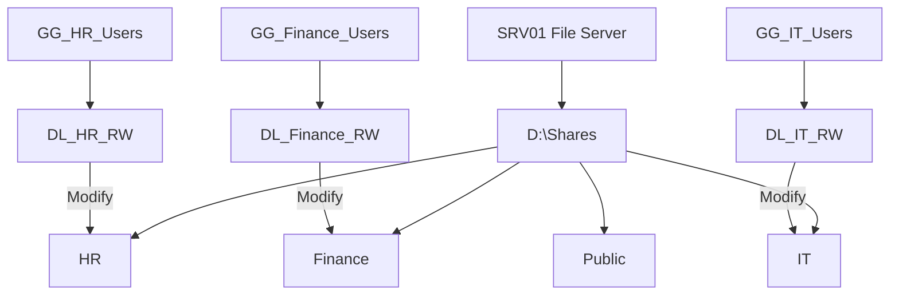
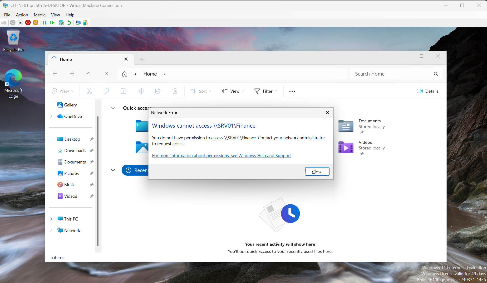

# File Services and Permissions

## Overview

SRV01 provides centralized file sharing with access controlled through Active Directory security groups.

The shares live on a dedicated data disk (`D:`), backed by a [separate virtual hard disk](../screenshots/srv01/added-file-server-vhdx.png) attached to SRV01, so share data is kept off the operating system volume.

### Permissions

| Folder | Security Group | NTFS Permission |
|---|---|---|
| HR | DL_HR_RW | Modify |
| Finance | DL_Finance_RW | Modify |
| IT | DL_IT_RW | Modify |
| Public | Authorized users | Read |

On the departmental folders, inheritance is disabled so that only Administrators, SYSTEM, and the department's domain local group have [access](../screenshots/security/ntfs-permissions.png).

## Validation

From CLIENT01:
- Members of a department's group could open, create, and modify files in that department's share.
- Users outside the department were denied access.

<table>
  <tr>
    <td width="50%"></td>
    <td width="50%"></td>
  </tr>
  <tr>
    <td align="center"><b>Authorized:</b> Finance user creates and edits <code>test.txt</code></td>
    <td align="center"><b>Denied:</b> user outside Finance is blocked</td>
  </tr>
</table>

## Key Takeaway
Combining AD security groups with SMB and NTFS permissions enables centralized, role-based access to shared resources.