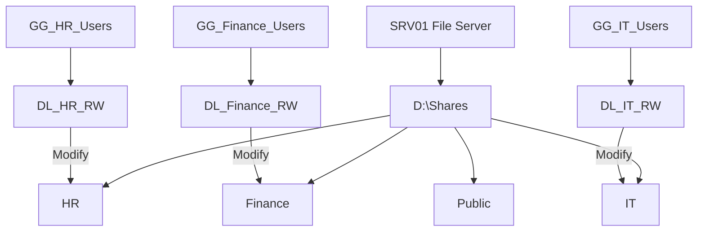

# File Services and Permissions

## Overview



SRV01 will provide centralized file sharing with access controlled through Active Directory security groups.

## Planned Configuration

```text
D:\Shares
├── HR
├── Finance
├── IT
└── Public
```

### Permissions

| Folder | Security Group | NTFS Permission |
|---|---|---|
| HR | DL_HR_RW | Modify |
| Finance | DL_Finance_RW | Modify |
| IT | DL_IT_RW | Modify |
| Public | Authorized users | Read |

SMB share permissions and NTFS permissions were configured to ensure departmental access.

## Validation

From CLIENT01:
- HR users could access `\\SRV01\HR`.
- Finance users were denied access to the HR share.
- Authorized users were able to create and modify files in their respective departmental shares.

## Key Takeaway
Combining AD security groups with SMB and NTFS permissions enables centralized, role-based access to shared resources.