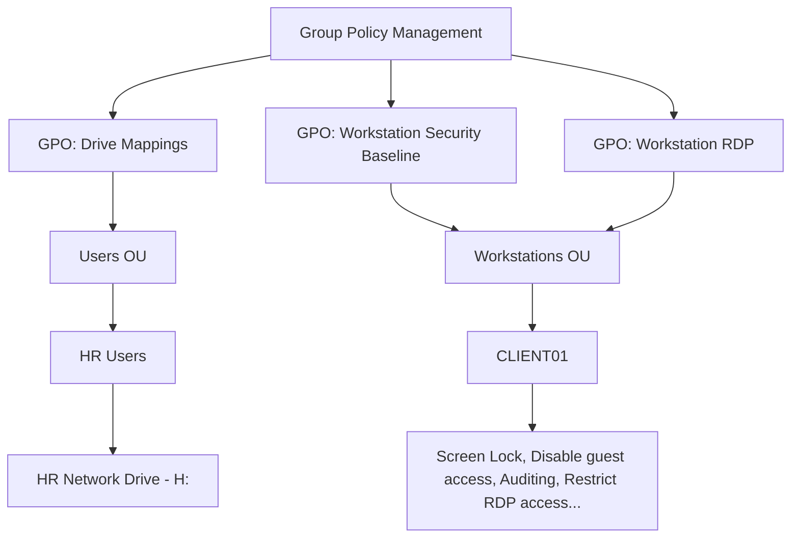
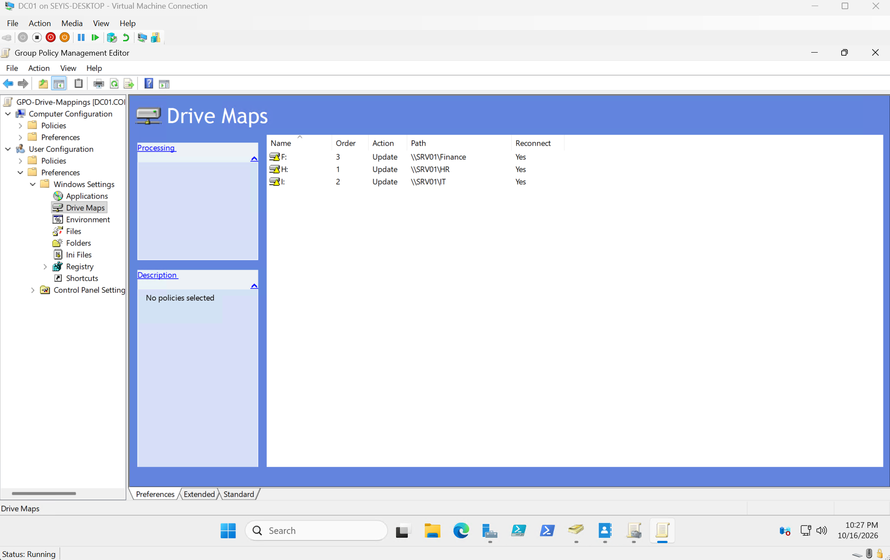
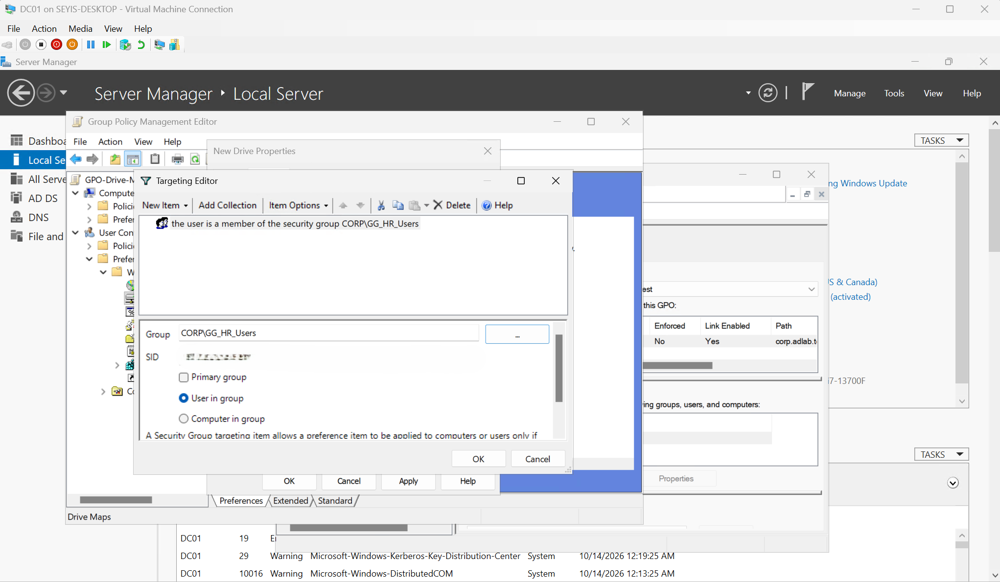
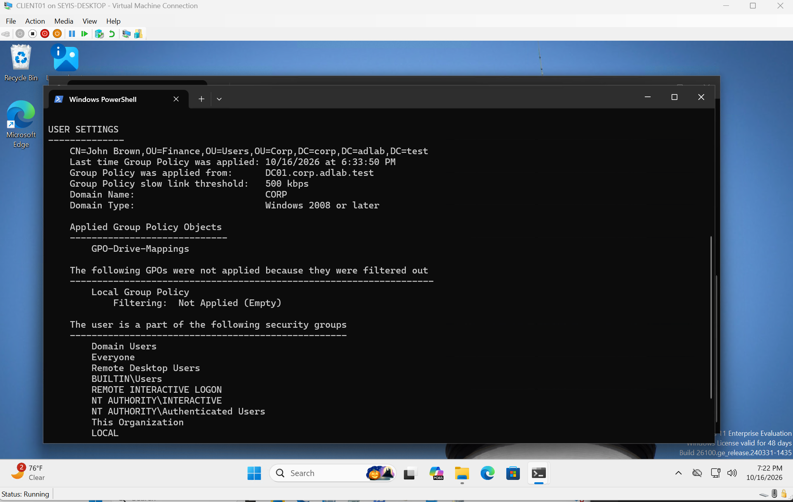

# Group Policy Configuration

## Overview



| GPO | Linked To | Purpose |
|---|---|---|
| `GPO-Drive-Mappings` | Users OU | Maps each department's network drive |
| `GPO-Workstation-Security-Baseline` | Workstations OU | Workstation hardening |
| `GPO-Workstation-RDP` | Workstations OU | Remote Desktop access for approved users |

## Drive Mappings

`GPO-Drive-Mappings` uses Group Policy Preferences to map departmental shares, with Reconnect enabled so the drives persist across sign-ins:

| Drive | Path |
|---|---|
| F: | `\\SRV01\Finance` |
| H: | `\\SRV01\HR` |
| I: | `\\SRV01\IT` |



Item-level targeting limits who receives a mapping. `H:` only maps for members of `CORP\GG_HR_Users`:



## Workstation Security Baseline

`GPO-Workstation-Security-Baseline` applies workstation hardening settings such as screen lock, disabling guest access, and auditing.

## Workstation RDP

`GPO-Workstation-RDP` adds `CORP\GG_Workstation_RDP_Users` to the local `Remote Desktop Users` group on workstations, so only approved users can sign in over RDP. Why this is a separate GPO is covered in [Troubleshooting #1](./troubleshooting.md#1-hyper-v-enhanced-session-authentication-failure).

## Validation

Ran on CLIENT01:

```powershell
gpupdate /force
gpresult /r
gpresult /r /scope computer    # requires an elevated session
```

The computer-scope report shows all three computer GPOs applied from DC01:


The user-scope report for Finance user `jbrown` shows `GPO-Drive-Mappings` applied:



## Key Takeaway
Group Policy allows administrators to distribute configurations across multiple computers without configuring each device manually.