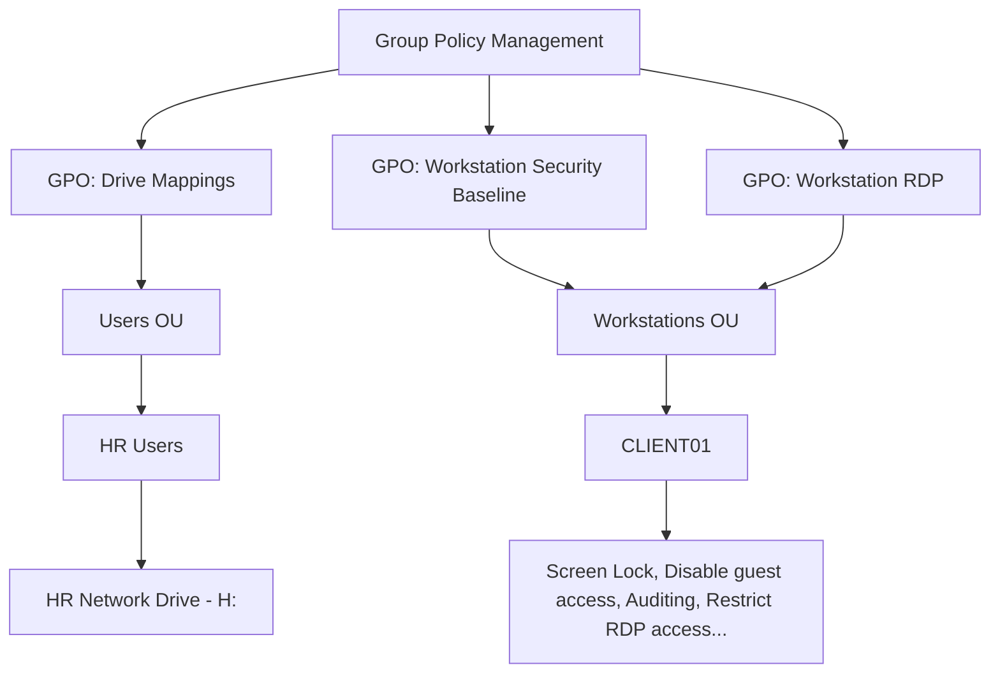

# Group Policy Configuration

## Overview



## Validation

Ran on CLIENT01:

```powershell
gpupdate /force
gpresult /r
gpresult /r /scope computer
```

Verified that the expected GPOs were applied successfully.

## Key Takeaway
Group Policy allows administrators to distribute configurations across multiple computers without configuring each device manually.