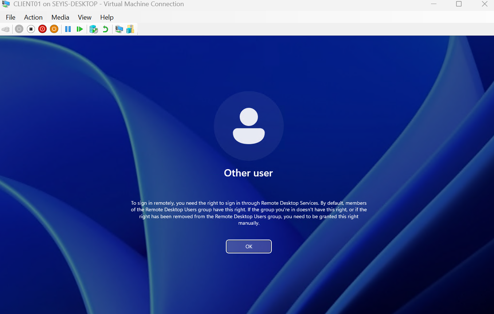
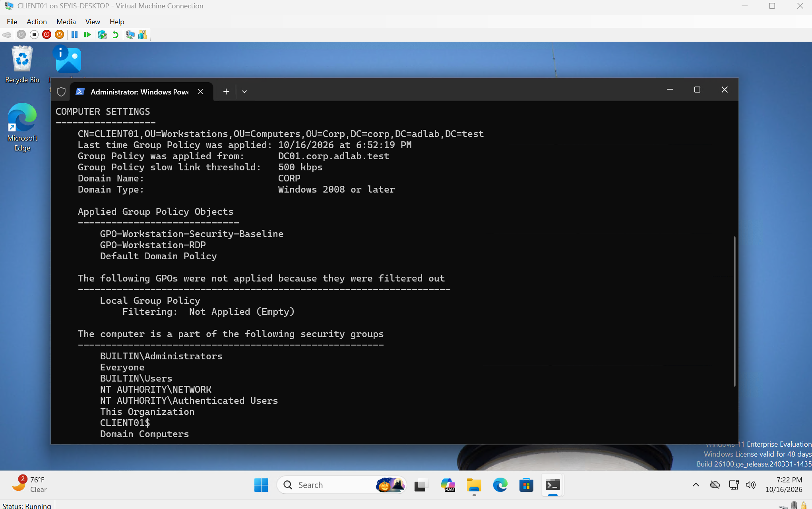

# Active Directory Enterprise Lab: Troubleshooting Log

This document tracks configuration issues, root cause analyses, and resolutions encountered during the deployment of the enterprise lab environment.

## 1. Hyper-V Enhanced Session Authentication Failure

**Issue:** 
Standard domain users were unable to authenticate into the domain-joined client virtual machine using the Hyper-V console.

**Symptoms:** 
Attempting to log into CLIENT01 as a newly created standard user resulted in the error: *"To sign in remotely, you need the right to sign in through Remote Desktop Services."*



**Investigation:** 
Identified that the Hyper-V console defaults to "Enhanced Session Mode," which relies on the Remote Desktop Protocol (RDP). Standard users lack local RDP rights by default. Disabling Enhanced Session allowed logins to succeed, confirming the issue was tied specifically to RDP rights, not Active Directory authentication.

**Root Cause:** 
The `CORP\Domain Users` group is not inherently a member of the local `Remote Desktop Users` group. 

**Resolution:** 
Instead of configuring the local machine manually, I implemented an enterprise-wide fix using Group Policy. 
1. Edited `GPO-Workstation-Security-Baseline`.
2. Navigated to `Computer Configuration > Preferences > Control Panel Settings > Local Users and Groups`.
3. Created an Update rule to explicitly add `CORP\Domain Users` to the built-in `Remote Desktop Users` local group.

**Security Improvement:**
To follow the principle of least privilege, I removed the Domain Users rule from the baseline and created `GPO-Workstation-RDP` to grant RDP only to `GG_Workstation_RDP_Users`. This new GPO is configured to automatically assign the `CORP\GG_Workstation_RDP_Users` group as members of the built-in Remote Desktop Users group. Only authorized users are added to this group.

**Validation:** 
Executed `gpupdate /force` on CLIENT01 via a basic session. Closed the console, re-enabled Enhanced Session, and successfully authenticated as a standard domain user.


## 2. Group Policy Scope Visibility Constraints

**Issue:** 
After successfully pulling the GPO, `gpresult /r` still did not list the Computer Configuration policy when executed by a standard user.

**Symptoms:** 
Standard user `jbrown` could log in via Enhanced Session (proving the GPO worked), but generating a policy report as that user would not show the GPO being applied.

**Investigation:** 
Standard users lack the local security privileges to read the applied Computer Configuration policies. 

**Root Cause:** 
By design, running `gpresult` without any administrative privilege only returns the User Scope. 

**Resolution / Validation:** 
Opened PowerShell as an administrator and executed `gpresult /r /scope computer`. The report listed `GPO-Workstation-Security-Baseline` and `GPO-Workstation-RDP` under Applied Group Policy Objects.



## 3. DHCP Authorization Kerberos Issue

**Issue:**
SRV01 displayed a Kerberos/authentication error when completing DHCP post-install configuration.

**Symptoms:**
- DHCP Server role installed successfully.
- The DHCP post-install configuration wizard failed when attempting to authorize the server in Active Directory.
- The error appeared to be related to domain authentication/Kerberos.

**Investigation:**
Verified that SRV01 was domain joined and could communicate with DC01.

The logged-in account was checked with `whoami`

The result showed that SRV01 was being administered using the local Administrator account rather than a domain administrative account.

**Root Cause:**
The DHCP authorization process requires permission to modify the list of authorized DHCP servers in Active Directory.

The local SRV01 Administrator account had administrative rights on SRV01 but did not have the required permissions in the `corp.adlab.test` domain.

**Resolution:**
Logged out of the local Administrator account and signed into SRV01 using the `CORP\Administrator` account.

The DHCP post-install configuration was then completed successfully, allowing SRV01 to be authorized in Active Directory.

**Validation:**
Verified the authorized DHCP servers with `Get-DhcpServerInDC`

Confirmed that SRV01 appeared as:

```text
10.10.10.20    SRV01.corp.adlab.test
```

DHCP configuration could then proceed normally.

## 4. Removed GPO Setting Left RDP Access in Place

**Issue:**
After moving RDP access to `GPO-Workstation-RDP`, a new user with no group memberships could still sign in through Enhanced Session.

**Investigation:**
`Get-LocalGroupMember -Group "Remote Desktop Users"` on CLIENT01 showed three members: `CORP\GG_Workstation_RDP_Users`, plus `CORP\Domain Users` left over from the original baseline rule and `CORP\ajohnson`, a user I added manually during earlier testing.

**Root Cause:**
Group Policy Preferences used the `Update` action, which only adds members. Removing the original rule from the baseline GPO stopped it from applying, but did not remove the membership it had already created.

**Resolution:**
Enabled "Delete all member users" and "Delete all member groups" on the Remote Desktop Users item in `GPO-Workstation-RDP`, so the group's membership is enforced every time the policy refreshes.

**Validation:**
After `gpupdate /force`, only `CORP\GG_Workstation_RDP_Users` remained in the local group. A user outside that group received "To sign in remotely, you need the right to sign in through Remote Desktop Services."